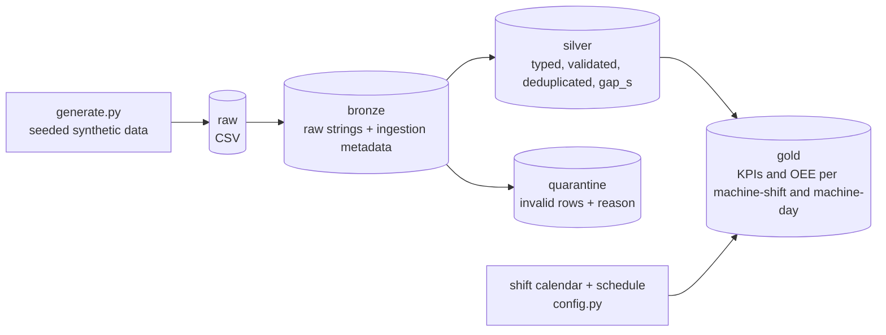
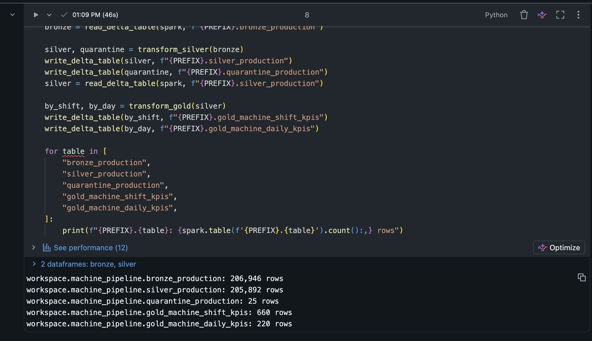
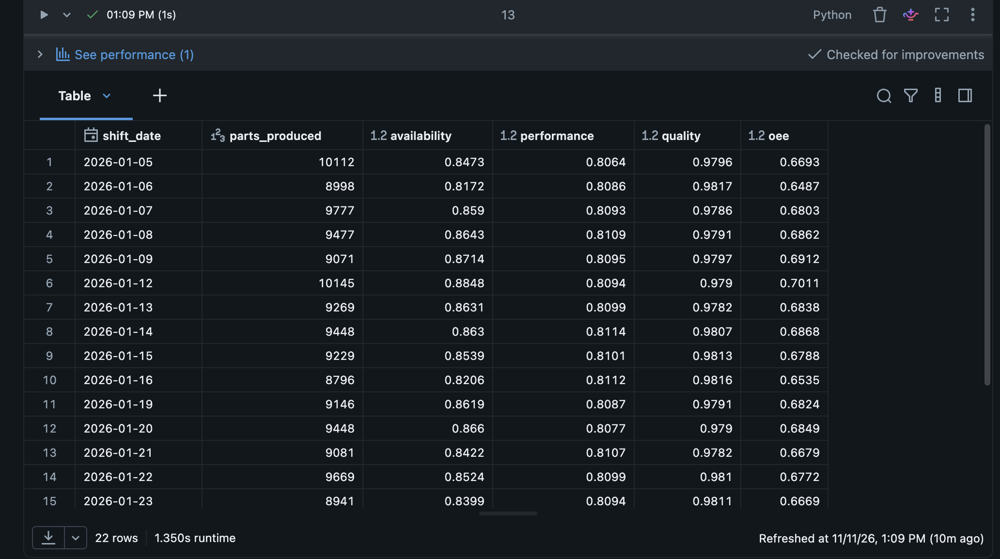

# machine-data-pipeline

[](https://github.com/cehicd1/machine-data-pipeline/actions/workflows/ci.yml)

A PySpark medallion pipeline (bronze → silver → gold) that turns raw CNC
part-production events into shift and daily OEE. It runs locally with Parquet
and on Databricks Free Edition with Unity Catalog Delta tables, using the same
transformation code.

All data is synthetic. No real company, machine or production data is used.

## Problem

A CNC machine logs one row per finished part: machine, product, timestamp,
cycle time and a scrap flag. The log has no record of stoppages, breaks or
shift plans, and like most real logs it has duplicates and broken rows.

Production managers need to know per machine and shift: how much was produced,
how much was scrap, how long the machine stood still, and the resulting
**OEE** (Overall Equipment Effectiveness = availability × performance × quality).
The pipeline cleans the log, derives downtime from gaps between parts, and
calculates OEE against the shift calendar.

## Architecture



| Layer      | What happens                                                                                   |
|------------|------------------------------------------------------------------------------------------------|
| bronze     | CSV read with an explicit all-string schema and header check; adds `source_file`, `ingested_at` |
| silver     | `try_cast` types, rule-based validation, dedup by `part_id`, `gap_s` per machine via `lag`     |
| quarantine | rows that fail any rule, with raw values and all failed rules in `quarantine_reason`           |
| gold       | planned time from the shift calendar, downtime from gaps, OEE; one Spark SQL twin aggregation  |

Each step is a small function that takes and returns a DataFrame. Storage is
isolated in `storage.py` (Parquet locally, Delta on Databricks), and all
settings live in `config.py`.

## Data model

| Table                | Grain                       | Key columns                                | Main columns |
|----------------------|-----------------------------|--------------------------------------------|--------------|
| raw / bronze         | one row per logged part     | `part_id`                                  | `machine_id`, `product_code`, `produced_at`, `cycle_time_s`, `is_scrap` (all strings), `source_file`, `ingested_at` |
| silver               | one row per unique part     | `part_id`                                  | typed columns + `gap_s` (seconds since the machine's previous part) |
| quarantine           | one row per invalid record  | –                                          | raw columns + `quarantine_reason` |
| `machine_shift_kpis` | machine × shift             | `machine_id`, `shift_date`, `shift_name`   | `planned_min`, `parts_produced`, `scrap_count`, `good_count`, `median_cycle_time_s`, `downtime_min`, `run_time_min`, `ideal_time_min`, `availability`, `performance`, `quality`, `oee`, `is_scheduled` |
| `machine_daily_kpis` | machine × production day    | `machine_id`, `shift_date`                 | same KPIs, computed from daily totals |

A night shift belongs to the day it starts (Monday 22:00 – Tuesday 06:00 is
Monday). The schedule is Monday to Friday, three 8-hour shifts, each with a
30-minute planned break.

### OEE rules

- **Planned time** = scheduled shift time minus planned breaks. Unscheduled
  shifts (weekends) have no planned time; any parts made there are counted, but
  their OEE is null instead of 0%.
- **Downtime** = idle time from gaps longer than `DOWNTIME_THRESHOLD_S` (300 s),
  clipped to planned time. Breaks and weekends never count as downtime;
  stoppages and product changeovers do. A gap across a shift boundary is split
  between the two shifts.
- **Availability** = run time / planned time. **Performance** = ideal cycle
  time × parts / run time. **Quality** = good parts / all parts.
- **Higher levels** (day, fleet) are computed from summed times and counts,
  never by averaging shift ratios. The gold tables include the additive columns
  (`planned_min`, `run_time_min`, `ideal_time_min`, `good_count`,
  `parts_produced`) so consumers can do the same.

## How to run

Requirements: Python 3.11+ (3.13 by default, override with `PYTHON=...`) and Java 17.

```bash
make setup   # virtualenv + package with dev dependencies
make data    # synthetic CSV -> data/raw/
make run     # bronze -> silver -> gold
```

`make test` runs the tests and `make lint` runs ruff.

## Databricks

On Databricks Free Edition, add the repo as a Git folder and run
`databricks/run_pipeline.py` on serverless compute. See
[databricks/README.md](databricks/README.md). The notebook writes every layer as
a Unity Catalog Delta table. It was verified on Free Edition serverless, with
row counts identical to the local run (206,946 bronze, 205,892 silver,
25 quarantine, 660 shift and 220 day gold rows).



The notebook ends with fleet OEE per day in Spark SQL, computed from summed
times and counts:



## Sample output

Default run (seed 42, 10 machines, 30 days): 206,946 raw rows, 25 quarantined,
1,029 duplicates removed, 205,892 silver parts, 660 machine-shifts, 220 machine-days.

`machine_shift_kpis`, first rows:

| machine_id | shift_date | shift_name | planned_min | parts_produced | scrap_count | median_cycle_time_s | downtime_min | availability | performance | quality | oee    |
|------------|------------|------------|------------:|---------------:|------------:|--------------------:|-------------:|-------------:|------------:|--------:|-------:|
| M01        | 2026-01-05 | early      | 450.0       | 235            | 8           | 97.3                | 68.35        | 0.8481       | 0.8210      | 0.9660  | 0.6726 |
| M01        | 2026-01-05 | late       | 450.0       | 372            | 5           | 46.4                | 105.09       | 0.7665       | 0.8353      | 0.9866  | 0.6316 |
| M01        | 2026-01-05 | night      | 450.0       | 409            | 6           | 46.9                | 53.19        | 0.8818       | 0.8274      | 0.9853  | 0.7189 |
| M02        | 2026-01-05 | early      | 450.0       | 306            | 9           | 61.5                | 96.99        | 0.7845       | 0.8287      | 0.9706  | 0.6310 |

Fleet totals over all scheduled days: availability 0.857, performance 0.81,
quality 0.98, **OEE 0.68**.

## Tests and CI

39 pytest tests run against a local SparkSession in about 20 seconds. They use
tiny hand-made datasets with known expected values:

- **silver:** quarantine reason for each kind of malformed row, deduplication,
  an invalid newer copy never replacing a valid row, gaps reset per machine
- **gold:**
  - shift assignment around midnight
  - planned break vs stoppage vs partial overlap
  - downtime threshold boundary (300 s vs 301 s)
  - gaps split across shifts, weekend gaps
  - unscheduled shifts, and scheduled shifts without parts
  - OEE math on a hand-made shift
  - day OEE from sums vs averaged shift OEE
  - Spark SQL result equal to the DataFrame result
- **bronze and generator:** raw strings kept, header check, reproducible seed,
  parts only in scheduled shifts

GitHub Actions runs `make lint` and `make test` on Python 3.12 and Java 17 for
every push and pull request ([workflow](.github/workflows/ci.yml)).

## Project layout

```
src/machine_pipeline/
  config.py      paths, shift calendar, schedule, products, thresholds
  shifts.py      shift calendar helpers
  generate.py    seeded synthetic data generator (standard library only)
  bronze.py      raw CSV -> bronze
  silver.py      validation, quarantine, dedup, gap_s
  gold.py        planned time, downtime, OEE
  sql/           Spark SQL version of the shift production aggregation
  storage.py     Parquet / Delta read and write
  pipeline.py    local entry point (make run)
tests/           pytest suite
databricks/      Databricks notebook (source format) and setup guide
```

## How this was built

I designed this project and reviewed every step: the medallion structure, the
OEE rules (breaks out of planned time, unscheduled shifts excluded instead of
reported as 0%, roll-ups from sums instead of averaged ratios), and the test
cases that pin these rules down. The code was implemented with AI assistance
(Claude Code), in small reviewed steps with one commit each. I ran and verified
the Databricks notebook on Databricks Free Edition myself.
