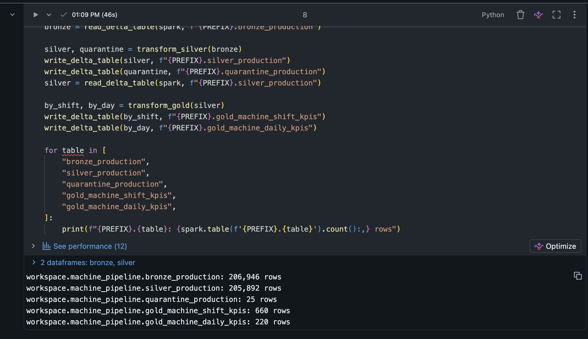
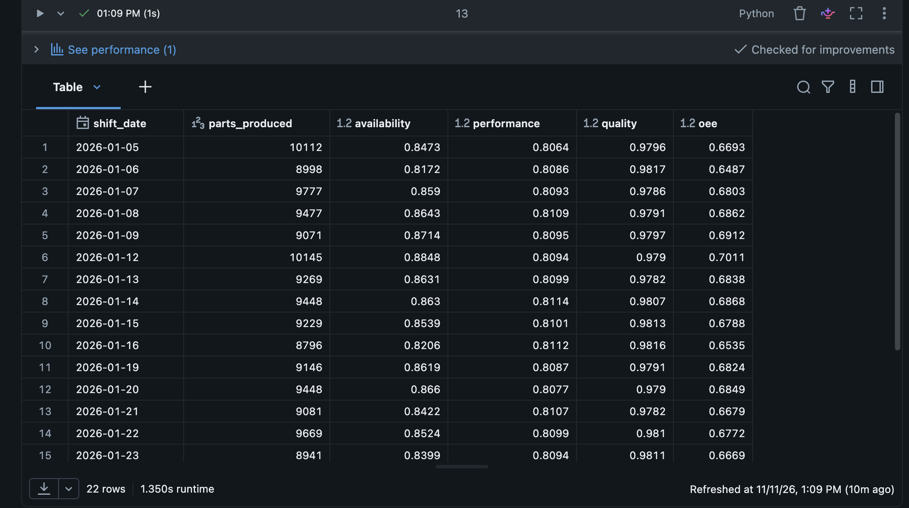

# Running on Databricks Free Edition

The notebook `run_pipeline.py` (Databricks source format) runs the same pipeline
as `make run`. Each layer is stored as a Unity Catalog Delta table instead of a
Parquet folder. Only the storage calls differ; the transformations are imported
from `src/machine_pipeline`.

**Verified** on Databricks Free Edition with serverless compute (November 2026).
Row counts match the local run exactly:

| Table                     | Rows    |
|---------------------------|--------:|
| `bronze_production`       | 206,946 |
| `silver_production`       | 205,892 |
| `quarantine_production`   | 25 (all 6 quarantine reasons) |
| `gold_machine_shift_kpis` | 660     |
| `gold_machine_daily_kpis` | 220     |

## Steps

1. Sign up for [Databricks Free Edition](https://www.databricks.com/learn/free-edition).
2. In the workspace, click **Workspace -> Create -> Git folder** and enter
   `https://github.com/cehicd1/machine-data-pipeline`. A public repo needs no Git credentials.
3. Open `databricks/run_pipeline.py` in the Git folder.
4. Attach **Serverless** compute. In the **Environment** side panel, select the
   latest environment version (Python 3.12 or newer).
5. Click **Run all**.

The notebook creates the schema `workspace.machine_pipeline`, a volume `raw` for
the generated CSV, and these tables:

| Table                     | Content                                        |
|---------------------------|------------------------------------------------|
| `bronze_production`       | raw CSV as strings + `source_file`, `ingested_at` |
| `silver_production`       | typed, validated, deduplicated parts + `gap_s` |
| `quarantine_production`   | invalid rows + `quarantine_reason`             |
| `gold_machine_shift_kpis` | OEE per machine and shift                      |
| `gold_machine_daily_kpis` | OEE per machine and day                        |

Change the `catalog` and `schema` widgets at the top to write somewhere else.
To get the latest code, use **Pull** in the Git folder menu.
